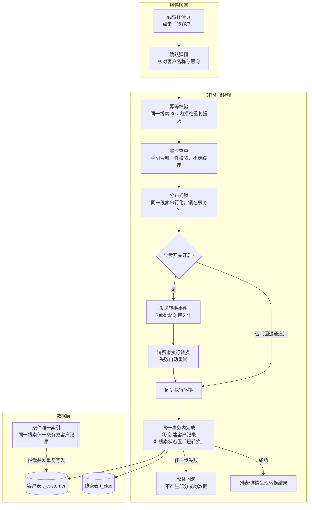

# PRD · 线索管理与客户转换

> 版本 v1.0 ｜ 维护：ShigureYukina
> 定位说明：本文档是 dlyk-2in1 治理线实践环境的**需求侧文档**。功能清单以仓库内真实实现为准
> （后端接口见 `dlyk-server/src/main/java/com/dlyk/web/`，前端页面见 `dlyk-front/src/router/router.js`），
> 性能与数据口径与 `docs/load/`、`docs/perf/` 同源，不引入未实现的功能。

---

## 一、需求背景

### 1.1 业务场景

公司为约 50 人规模的建设工程企业，销售链路为「市场活动获客 → 线索录入与跟进 → 转为客户 → 推进交易」。
线索是整条链路的入口：市场部在活动中收集的意向客户、销售手工录入的来电咨询，都先落到线索池，
由负责人跟进验证意向后，转成正式客户并创建交易。

线索数据的两个特点决定了本模块的设计重心：

- **增长快**：系统运行两年后，线索及相关流水数据达 30 万级（压测环境按 35.6 万行造数，见 `docs/load/README.md`）；
- **强重复风险**：同一客户可能被多个销售在多个渠道重复录入，手机号是天然的业务唯一键。

### 1.2 目标用户与角色

系统采用五类角色（`dlyk.sql` 中 `t_role` 实证），本模块涉及其中四类：

| 角色 | 在本模块中的诉求 |
| --- | --- |
| 销售员（saler） | 快速录线索、查重、跟进记录不丢、一键转客户 |
| 销售经理（manager） | 掌握线索总量与转化情况，查看下属线索明细 |
| 市场营销（marketing） | 活动收集的线索批量导入，按活动来源检索 |
| 管理员（admin） | 维护线索字段字典、处理异常数据（删除/批量删除） |

权限模型为三级树（顶级菜单 → 子菜单 → 按钮级权限），线索模块拆分到
`clue:list / add / edit / view / delete / import` 等按钮粒度，由 `t_permission` / `t_role_permission` 控制，
前端侧边栏与操作按钮按用户权限动态渲染。

### 1.3 问题与机会

| 现状问题 | 影响 | 对应需求 |
| --- | --- | --- |
| 重复录入：同一手机号被并发提交产生重复数据 | 跟进对象混乱，统计失真 | 实时查重 + 双层防重（F4） |
| 转客户同步阻塞：转换期间页面等待，重复点击产生脏数据 | 体验差、数据脏 | 异步化 + 幂等（F5） |
| 关键字检索走 MySQL `LIKE`，30 万级下体验差 | 找不到人、找得慢 | ES 检索（F2） |
| 列表在数据量上涨后变慢 | 跟进效率下降 | 见《PRD-列表体验治理专项》（独立文档） |

## 二、目标与成功指标

**业务目标**：线索从录入到转客户的全流程在系统内闭环，跟进过程可追溯，重复数据不再产生。

| 指标 | 目标 | 度量方式 |
| --- | --- | --- |
| 并发重复率 | 重复提交场景下零重复 | 并发用例（20 线程同一线索提交），实证见 README「并发一致性」行 |
| 转客户主流程耗时 | 主流程不因异步链路失败而阻塞 | 转换动作由消息消费者执行，失败重试，开关可回退同步 |
| 检索可用性 | ES 故障时检索功能不中断 | ES 异常回落 MySQL 列表（`docs/es/README.md`） |
| 数据回溯能力 | 每条线索的跟进记录完整可查 | 详情页跟进记录（remark）持久化 |

## 三、用户故事

1. 作为**销售员**，我希望录入线索时系统立刻告诉我手机号是否已被登记，避免录入一条重复线索。
2. 作为**销售员**，我希望跟进一次就记一条备注（时间、内容自动带出），换班时接手的同事能看到完整过程。
3. 作为**销售员**，我点击「转客户」后不用守着页面等结果，系统会把转换做完并保留结果可查。
4. 作为**市场营销**，我希望能把活动收集的 Excel 名单一次性导入，而不是逐条手录。
5. 作为**销售经理**，我希望按关键字（姓名/手机号）快速检索线索，而不是翻页找。
6. 作为**管理员**，我删除或批量删除线索时，系统应防止误删已被转换的线索。

## 四、功能需求

优先级定义：P0 = 主流程缺失则模块不成立；P1 = 高频体验项；P2 = 体验增强。

### F1 线索列表（P0）

| 项 | 说明 |
| --- | --- |
| 入口 | `/dashboard/clue` |
| 分页 | 支持偏移分页与**游标分页**两套接口（`/api/clues` 与 `/api/clues/cursor`），游标分页用于深翻页场景，扫描行数与页码无关 |
| 展示 | 线索主字段 + 负责人、意向状态等关联信息（联查字典/用户/产品表） |
| 操作 | 编辑、删除、批量删除、导出（单条/勾选）、转客户入口 |
| 检索 | 关键字检索接 ES（见 F2）；列表 total 与分页性能的治理见《PRD-列表体验治理专项》 |

### F2 关键字检索（P1）

- 以 ES 为检索副本、MySQL 为主库：线索的增删改通过事件（`clue.changed` / `clue.deleted`）增量同步至 ES。
- ES 检索命中后回 MySQL 拼详情，保证详情数据与主库一致。
- **降级规则**：ES 查询异常时回落 MySQL 列表并告警，功能不中断；提供 `POST /api/es/reindex`（admin）全量重建兜底。
- 开关：`DLYK_ES_ENABLED`，默认关闭，关闭时行为与原列表检索一致。

### F3 线索录入与编辑（P0）

- 入口 `/dashboard/clue/add`、`/dashboard/clue/edit/:id`。
- 必填校验：姓名、手机号；意向状态、来源等取自字典（`t_dic_value`）。
- **手机号查重**：提交前调用 `/api/clue/{phone}` 实时校验。
  该校验**必须实时、禁止缓存**——查重的价值就在于实时性，缓存一分钟都可能放进一条重复线索
  （压测报告将其单列为不可缓存项，见 `docs/load/README.md` 第六节）。
- 字段变更记录创建人/时间。

### F4 数据防重与一致性（P0）

防重采用**应用层控制 + 库层兜底**双层设计，规则层面只允许"同一线索只有一个有效转换结果"：

| 层 | 机制 | 拦截的场景 |
| --- | --- | --- |
| 应用层（提交入口） | 幂等切面：同一线索 30 秒窗口内拒绝重复提交 | 手抖双击、网络重试 |
| 应用层（执行层） | 分布式锁按线索 ID 串行化，锁在事务外 | 多个销售同时转同一条线索 |
| 库层 | 条件唯一索引：同一线索仅允许一条有效客户记录 | 以上全部失效时的最后防线，防止部分成功脏数据 |

- 转换动作（创建客户 + 线索置「已转换」）在**同一事务**内完成，任一步失败整体回滚，
  不允许出现"客户已落库、线索仍可再次转换"的部分成功状态。
- 并发验证：20 线程并发提交同一线索的用例，结果零重复。

### F5 线索转客户（P0，核心流程）

- 入口：线索详情/列表的「转客户」操作，`POST /api/clue/convert/{id}`。
- 前置条件：线索未被转换过（state != -1）；通过 F4 全部校验。
- 动作：按线索信息创建客户记录，线索状态置「已转换」；转换后的客户可继续创建交易（客户模块能力）。
- 执行模式：默认经消息队列**异步执行**（事件持久化 + 消费重试），主流程不被转换耗时阻塞；
  保留同步开关作为回退通道——异步链路异常时可切回同步模式，两种模式复用同一套事务与防重规则。

**核心流程（泳道图）**：

**失败与回退路径**：

| 场景 | 行为 |
| --- | --- |
| 重复点击 / 网络重试 | 幂等切面在 30s 窗口内直接拒绝，不进入业务逻辑 |
| 消费失败 | 自动重试；重试期间线索保持原状态，可再次发起 |
| 异步链路整体不可用 | 运维开关切回同步模式，功能不中断（两种模式同规则） |
| 并发穿透全部应用层防线 | 库层条件唯一索引拦截，应用捕获后按"已被转换"提示 |

### F6 跟进记录（P1）

- 入口：线索详情页 `/dashboard/clue/detail/:id`。
- 每次跟进追加一条记录（内容 + 时间 + 记录人），只增不改不删，保证过程可回溯。
- 跟进记录为流水型数据，是线索表之外增长最快的数据；其分片扩容预案见 `docs/sharding/README.md`（按 clue_id 分 4 片的机制演练）。

### F7 Excel 导入 / 导出（P1）

- 导入：按模板批量导入线索（市场活动名单场景），导入前逐条走 F3 校验规则；
- 导出：支持单条导出与列表勾选导出，用于线下沟通与汇报。

### F8 线索删除（P2）

- 单条删除与批量删除，admin/授权角色可用；
- 已转换线索（state = -1）不允许物理删除，保证客户溯源链路完整。

## 五、非功能需求

| 维度 | 要求 | 依据 |
| --- | --- | --- |
| 数据一致性 | 转换动作零部分成功；并发场景零重复 | F4 双层防重 + 事务设计，README「并发一致性」实证 |
| 查重实时性 | 手机号查重接口不走任何缓存，逐次实时校验 | 压测报告明确其为不可缓存项 |
| 检索可用性 | ES 故障自动回落 MySQL，检索功能不中断 | `docs/es/README.md` |
| 列表性能 | 30 万级数据下列表可用 | 独立专项治理，见《PRD-列表体验治理专项》 |
| 权限 | 按钮级权限控制增删改查与导入 | 三级权限树（t_permission） |
| 审计 | 记录创建人与创建时间，删除留痕（deleted 软删） | dlyk.sql 含 deleted 列 |

## 六、数据与度量

- 线索转化漏斗在统计首页呈现（活动 → 线索 → 客户 → 交易柱状图与漏斗图），支撑销售经理复盘。
- 关键度量：线索总量、新增速率、转换率、重复拦截次数（幂等/查重/唯一索引三层各自计数）。

## 七、风险与开放问题

| # | 问题 | 状态 |
| --- | --- | --- |
| 1 | 异步消费重试耗尽后的兜底（死信队列 + 人工介入流程）尚未建设 | 开放：当前依赖重试与同步回退开关 |
| 2 | 公海机制未建设 | 取舍见《竞品分析-国内B端CRM》第四节：50 人规模下"负责人制"已覆盖诉求，暂不做 |
| 3 | ES 为检索副本，主库与副本存在秒级窗口 | 可接受：命中后回主库拼详情，详情始终与主库一致 |
| 4 | 批量导入的进度反馈与失败行导出 | 开放：P1 版本仅保证校验拦截与最终结果提示 |

## 八、验收标准（节选）

1. 录入重复手机号：实时提示重复并阻断提交；压测口径下该接口逐次查库，无缓存。
2. 20 线程并发提交同一条线索的转换：仅产生一条客户记录，线索状态正确置为已转换，零重复。
3. 转换过程中模拟"客户创建成功、线索状态更新失败"：整体回滚，数据库无部分成功痕迹。
4. 关闭 ES（或 ES 宕机）：关键字检索回落 MySQL，列表功能不报错、不中断。
5. 异步开关切回同步：转换功能全流程可用，行为与异步模式一致。

## 关联文档

- 性能治理：《PRD-列表体验治理专项.md》
- 压测口径：`docs/load/README.md` ｜ 慢查询治理：`docs/perf/README.md`
- 检索方案：`docs/es/README.md` ｜ 分表预案：`docs/sharding/README.md`
- 竞品参照：《竞品分析-国内B端CRM.md》
